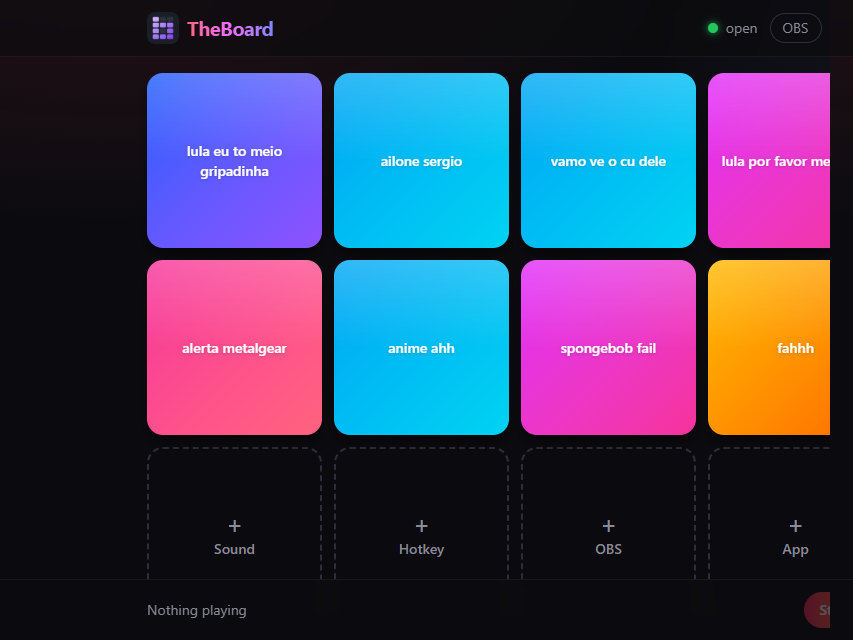
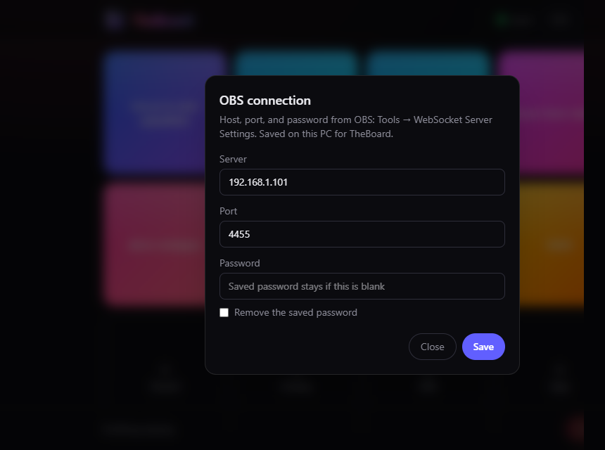

# StreamBoard

A LAN stream deck. Press a button on any PC, laptop, or phone, and the PC
running StreamBoard plays a sound, sends a hotkey, switches an OBS scene, or
starts an app.

Sounds that should show up in Discord, OBS, or another call have to go through
a virtual audio device. Use [VB-Audio Virtual Cable](https://vb-audio.com/Cable/)
or [SteelSeries Sonar](https://steelseries.com/gg/sonar). StreamBoard plays into
that device, and the other program selects it as its microphone. Details are
in [Virtual audio](#virtual-audio).



See [docs/DESIGN.md](docs/DESIGN.md) for the design notes.

## Layout

- `server/`: Rust server (axum): HTTP API, WebSocket, audio, actions. Serves the built UI.
- `web/`: React + Vite + Tailwind UI.
- `config/`: example config files.
- `installer/`: Windows setup script. GitHub Actions compiles it into `StreamBoard-Setup.exe`.

## Development

```sh
# terminal 1: server on :7878
cargo run -p soundboard-server

# terminal 2: UI with hot reload on :5173 (proxies /api and /ws to :7878)
cd web && npm install && npm run dev
```

Open `http://localhost:5173`, or `http://<this-pc-ip>:5173` from your phone.

Regenerate the TypeScript protocol types after changing `server/src/protocol.rs`:

```sh
cargo test -p soundboard-server
```

## Sounds and hotkeys

- **+ Sound** on the board uploads mp3, ogg, wav, flac or m4a files to the server.
  Files copied straight into `~/.local/share/soundboard/sounds` (or `audio.sounds_dir`)
  show up within a few seconds too.
- **+ Hotkey** adds a button that presses a key combo on the server, like
  `super+shift+b`. It uses `ydotool`, so `ydotoold` must be running
  (`systemctl --user enable --now ydotool`).
- **Edit** lets you rename, re-key or delete buttons. Deleting a sound also deletes its file.

The board is saved in `~/.local/share/soundboard/board.json`.

## OBS scenes

**+ OBS** adds a button that switches the program scene in OBS on this PC.
OBS has to be running with its websocket server enabled:

1. In OBS, open **Tools → WebSocket Server Settings**.
2. Enable the server. The default port is `4455`.
3. In StreamBoard, open **OBS** (or the tray item **OBS settings**) and enter the same host, port, and password. They are saved in `config.toml`:

```toml
[obs]
host = "127.0.0.1"
port = 4455
password = "the-password-from-obs"
```



The server connects when you open **+ OBS** or press a scene button, so it still
starts when OBS is closed. A failed press shows the OBS error on the board.

## Apps

**+ App** starts a program on the PC running the server. Pick a Start menu
shortcut, or paste the path to an `.exe` or `.lnk`. On Linux, pick a
`.desktop` file or an executable (`gio launch` is used for desktop files).

The server starts that file directly. It does not run a command line, and it
refuses shells and scripts (`cmd`, PowerShell, `.bat`, and the like). A
shortcut can already contain the arguments an app needs.

## Reaching it from other devices

1. Allow the ports from the LAN (ufw is active on Omarchy):
   ```sh
   sudo ufw allow from 192.168.1.0/24 to any port 5173 proto tcp comment 'soundboard dev'
   sudo ufw allow from 192.168.1.0/24 to any port 7878 proto tcp comment 'soundboard'
   ```
2. On Android, Chrome and Brave need the **Nearby devices** / **Local network**
   permission (Settings → Apps → Chrome → Permissions), then a browser restart.
   Without it, requests to LAN addresses are silently dropped. The stock browser
   usually works without it.
3. If it still fails: turn off "Always use secure connections" (Chrome) or
   "Upgrade connections to HTTPS" (Brave), pause VPN/ad-block DNS apps, and
   check the router for AP/client isolation.

## Running the server on Windows

Download [StreamBoard-Setup.exe](https://github.com/phbraz/deckboard/releases/latest)
and run it. That is the install. Details are in [Install](#install).

The server also runs from a `soundboard-server.exe` you build yourself. Sounds
play through the default output and hotkeys are sent with `SendInput`. Clients
are browsers, as on Linux.

1. Get `soundboard-server.exe`, using any one of these:
   - Build it with Docker (Docker Desktop on Windows works). This writes the
     Windows and Linux binaries to `dist/`:
     ```sh
     docker build --target artifacts --output type=local,dest=dist .
     ```
     The container only builds the binary. The server can't run inside Docker,
     because a container can't reach the host's audio devices or keyboard input.
   - Download it from the latest **build** workflow run on GitHub (artifact `soundboard-Windows`).
   - Cross-compile it on Linux with [cargo-zigbuild](https://github.com/rust-cross/cargo-zigbuild):
     ```sh
     (cd web && npm run build)
     rustup target add x86_64-pc-windows-gnu
     cargo zigbuild --release -p soundboard-server --target x86_64-pc-windows-gnu
     ```
   - Build it on Windows with Rust and Node installed: `cd web; npm ci; npm run build; cd ..; cargo build --release`.
2. Run it. A debug `cargo run` prints the address to open on your phone, e.g. `open http://192.168.1.50:7878`, and Ctrl+C stops it. A release build keeps the console hidden and adds a tray icon with **Open**, **OBS settings**, and **Quit**.
3. Allow it through Windows Firewall. Accept the prompt on first run and tick
   **Private networks**, or from an admin PowerShell:
   ```powershell
   New-NetFirewallRule -DisplayName "Soundboard" -Direction Inbound -Protocol TCP -LocalPort 7878 -Profile Private -Action Allow
   ```
   Your Wi-Fi must be set to **Private** in Windows settings. On a "Public"
   network, Windows blocks other devices.

On Windows, files live in `%APPDATA%\soundboard\`. That folder holds
`config.toml`, `board.json` and `sounds\`.

### Install

Each push to `master` builds `StreamBoard-Setup.exe` and attaches it to the
[latest release](https://github.com/phbraz/deckboard/releases/latest). The same
file is on that workflow run as the artifact `StreamBoard-Setup`. Inno Setup runs
in that build. Running the downloaded setup is the whole install.

Run `StreamBoard-Setup.exe`. It installs for the current user into
`%LocalAppData%\StreamBoard` and adds:

- a desktop shortcut
- a Start menu shortcut
- a Startup shortcut, so StreamBoard is in the tray after you sign in
- an uninstaller

The tray icon is the purple board mark. **Open** (or a double-click) shows the
board. **OBS settings** opens the connection form. **Quit** stops the server.
Launching StreamBoard again while it is already running opens the board in the
browser.

The first time it listens on port 7878, Windows asks whether to allow it on
private networks. Allow it on **Private**. Stop a dev server on port 7878
before starting the installed copy; both want that port.

To compile the setup on a Windows machine while changing the installer, install
[Inno Setup 6](https://jrsoftware.org/isinfo.php) and run:

```powershell
powershell -ExecutionPolicy Bypass -File installer/build.ps1
```

That writes `dist/StreamBoard-Setup.exe`. The script builds the UI and the release
exe first. The installer only copies the finished exe.

### Uninstall

In Windows, open **Settings → Apps → Installed apps**, choose **StreamBoard**, and
uninstall it. The same uninstaller is in the Start menu under **StreamBoard**.

Uninstall removes the program, the desktop and Start menu shortcuts, and the
Startup entry. Sounds, the board, and `config.toml` stay in
`%APPDATA%\soundboard`. Delete that folder when you also want the library gone.

### Virtual audio

Speakers are enough when you only want the room to hear a sound. Discord, OBS,
and other calls need a virtual device they can select as a microphone. Install
one of these on the PC running StreamBoard:

**SteelSeries Sonar.** Install SteelSeries GG and turn Sonar on. Set
`audio.output` to the channel you want, such as `Sonar - Microphone`,
`Sonar - Stream`, or `Sonar - Aux`. In Discord, pick that same Sonar channel
as the input device.

**VB-Audio Virtual Cable.** Install [VB-CABLE](https://vb-audio.com/Cable/) and
reboot if the installer asks you to. Set StreamBoard's output to `CABLE Input`.
In Discord or OBS, set the microphone to `CABLE Output`.

```toml
[audio]
output = "Sonar - Microphone"   # or "CABLE Input". Case-insensitive; a unique part of the name is enough
```

At startup the server logs every output it can see (`audio output devices`).
It refuses to start if the name matches more than one device, or none.

Hotkey notes for Windows:
- `super` is the Win key, so `win+shift+s` works as a combo.
- Windows only delivers keys to apps running as administrator if the server
  also runs as administrator.
- Ctrl+Alt+Del and Win+L can't be sent by any app.

## Production build

```sh
(cd web && npm run build)
cargo build --release -p soundboard-server
./target/release/soundboard-server   # UI is embedded; open http://<this-pc-ip>:7878
```
